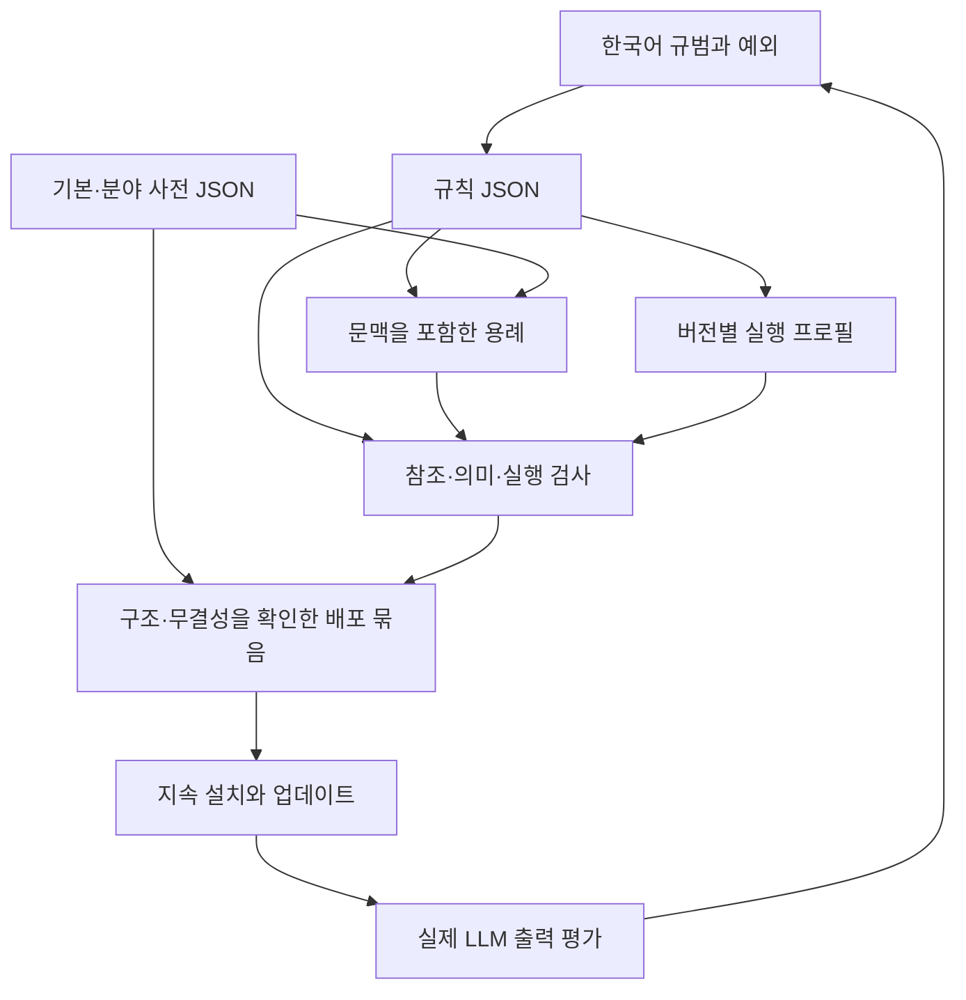

# Korean Protocol의 전체 구조

Korean Protocol은 한국어 LLM 답변과 업무·기술 문서에서 독자가 사실, 대상, 조건, 행동, 확실성을 같은 뜻으로 해석하도록 돕는 독립 규약이다. 초기 12개 편집 원칙을 어휘 통제, 한국어 문법, 문서 기능, 용례, 검사, 지속 배포의 체계로 확장한다. 이 문서는 `0.7.0-draft`의 체계 설계이며, 설계의 존재를 이해도 개선의 검증으로 취급하지 않는다. 현재 규칙은 72개, 규칙 작성자 사례는 296개, 사전은 기본 159뜻·분야 34뜻이다.

공개 서명 콘텐츠 `0.7.0·순번 3`과 관리 엔진 `0.2.0`은 역할과 버전이 다르다. 사용자 패키지 `v0.7.0`은 설치 도구·안내 원본 `7e01d53`에서 발행했으며 main의 후속 문서 개정은 기존 ZIP에 자동 반영되지 않는다. [현행 상태](../status/requirements.md)에서 각 근거의 범위를 확인한다.

## 1. 적용 범위와 우선순위를 정한다

우선 적용 범위는 한국어로 작성하는 작업 지시, 진행·결과 보고, 위험 안내, 제품·기술 설명이다. 문학·광고·친교 대화는 기본 적합성 판정 범위에 넣지 않는다. 계약, 법규, 의학·안전 절차의 정확한 인용과 공식 명칭은 임의로 바꾸지 않으며, 분야의 승인 절차를 이 규약이 대신하지 않는다.

적용 순서는 의미 보존, 독자의 판단·행동에 필요한 정보, 대상과 관계의 명확성, 어휘·문법의 일관성, 간결성이다. 사실·수량·단위·부정·조건·순서·동시성·주체·시점·증거 수준·가능성과 허락의 차이를 먼저 보존한다. 규칙끼리 충돌하면 해당 의미를 보존하고, 충돌한 규칙과 적용하지 않은 이유를 검사 결과에 남긴다.

현재 0.7.0-draft는 V7 r2의 구조 규칙을 채택한다. 대상 목록을 앞에 두고 선택지별 속성·조건별 결과·수량 기준·기한을 관련 행동과 묶는다. 배치를 바꾸어도 적용 범위와 시간의 기산 사건을 보존하며 원문보다 짧아야 한다는 기준은 두지 않는다. 새 설명·보고는 기본적으로 높임 없이 쓰며 사용자·호스트의 높임말 설정을 따른다.

“문제가 있을 수 있습니다”는 대상과 경고 맥락이 공유되면 적합하다. 이를 확정적 사실로 바꾸거나, 원문에 없는 원인·미실시 시험·확인 약속을 붙이지 않는다. 독자가 구체적인 문제를 묻는 상황에는 확인된 내용을 설명하되, 그 정보가 없으면 문장 수를 늘려 공백을 감추지 않는다.

## 2. 규범과 실행물을 구분한다

| 계층은 다음 자료로 구성된다. | 해당 계층은 다음 책임을 진다. | 해당 계층의 한계는 다음과 같다. |
| --- | --- | --- |
| 규범 원본은 `docs/spec/`에 둔다. | 적용 조건, 요구사항, 예외, 판정 방법, 변경 이유를 한국어로 설명한다. | 제목이나 선언만으로 규칙을 구현한 것으로 계산하지 않는다. |
| 기계 판독 규칙은 `specification/rules.json`에 둔다. | 안정적인 규칙 ID로 규범·용례·검사·프로필을 연결한다. | JSON 형식이 맞아도 의미가 정확하다는 보장은 없다. |
| 통제 어휘는 `lexicon/`에 둔다. | 의미 ID, 품사, 활용, 결합, 분야, 독자, 승인 상태와 예외를 기록한다. | 단어의 표면형을 찾는 것만으로 적합성을 판정하지 않는다. |
| 용례는 `examples/`에 둔다. | 문맥, 의도, 양호 사례, 부적합 사례, 원문 유지 사례를 규칙·어휘와 연결한다. | 저자가 만든 용례의 성공을 실제 독자 시험으로 보고하지 않는다. |
| 실행 프로필은 버전별 배포물에 포함한다. | 적용 중인 규칙·어휘·우선순위·미확인 정보 처리법을 지원 도구에 공급한다. | 파일을 설치한 사실만으로 LLM의 준수를 보장하지 않는다. |
| 검사기는 `validation/`과 `tests/`에서 관리한다. | 구조 오류, 참조 오류, 누락된 예외·용례와 검증 증거를 검사한다. | 문맥 의존 판단을 정규식의 확정 판정으로 바꾸지 않는다. |
| 배포 명세와 런타임은 `docs/distribution/`과 `runtime/`에서 관리한다. | 설치 지속성, 버전 고정, 업데이트 검사·적용·복구와 상태 확인을 제공한다. | 배포 시험은 규약의 언어학적 효과를 입증하지 않는다. |
| STE 기능 대응표는 `specification/ste-crosswalk.json`에 둔다. | 원본 53개 ID마다 한국어 설계와 실제 규칙·증거·공백을 연결한다. | 대응률은 한국어 규약 전체의 완성도를 대신하지 않는다. |

규범의 의미를 바꾸는 변경은 규범 원본에서 심사하고 같은 변경 묶음에서 JSON과 용례를 갱신한다. 현재 `validation.compile`은 그 버전의 규칙에서 세 실행 프로필과 상세 규약을 생성한다. 프로필은 72개 규칙을 담고 전체 사전은 별도 JSON으로 공급한다. 검토한 배포용 표현은 원본 요구사항·조건·예외의 해시와 연결하며, 컴파일 검사는 표현 간 의미 동등성을 자동 입증하지 않는다. 규범과 JSON의 뜻이 다르거나 프로필이 예외를 누락하면 릴리스를 막는다.

## 3. LLM의 작성·수정 절차를 정한다

1. 입력 문맥에서 독자, 문서 기능, 대상, 확정된 사실과 미확인 정보를 구분한다.
2. 수정 대상이면 의미 보존 항목을 기록하고, 새 작성이면 제공된 근거의 범위에서만 내용을 구성한다.
3. 활성화한 분야·프로젝트 어휘에서 의미와 결합이 맞는 표현을 고른다.
4. 한국어 조사·생략·수식·부정·양태·시상·종결형을 적용해 문장을 구성한다.
5. 지시·보고·경고·설명의 구조에 맞게 문장과 문단을 배열한다.
6. 사실 추가, 의미 손실, 문장 기능 변경이 있으면 해당 수정을 거부한다.
7. 문맥으로 판정할 수 없는 항목은 검토 대상으로 남긴다. 실제 결정을 바꾸는 정보가 빠졌을 때에만 필요한 확인을 요청한다.

실행 프로필은 사용자 요청과 상위 실행 환경의 지시를 덮어쓰지 않는다. 원문 인용, 코드, 경로, 식별자, 수식, 표의 상태값은 해당 형식으로 보존한다. 자연어를 바꾸는 검사와 리터럴의 동일성을 검사하는 절차를 구분한다.

## 4. 어휘 확장의 경계를 정한다

기본 어휘, 분야 어휘, 프로젝트 어휘를 함께 사용할 수 있다. 충돌을 단순한 파일 로드 순서로 해소하지 않고 개념 ID·분야·독자를 대조한다. 프로젝트의 실제 화면 이름은 찾을 수 있는 원래 이름으로 표시하며, 기본 사전의 의미를 전역에서 덮어쓰지 않는다.

전문 명사와 전문 동사의 신규 등록은 정의, 출처 또는 승인자, 사용 문맥, 품사·활용·결합, 양호 사례와 오용 사례를 요구한다. 한국어의 생산적인 `-하다` 결합과 명사형을 전면 금지하지 않으며, 새 결합이 승인된 개념·행동을 보존하는지 판단한다. 미등록 어휘는 자동 오답이 아니라 등록·검토 대상이며, 지원 분야의 승인 어휘 충족률과 함께 보고한다.

## 5. 변경과 배포의 계약을 정한다

규칙과 의미 ID는 발행 뒤 다른 의미에 재사용하지 않는다. 폐기·분리·통합은 이전 ID와 후속 ID의 관계, 바뀐 적용 조건, 필요한 마이그레이션을 남긴다. 편집 수정, 규칙 의미 변경, 스키마 호환성 변경을 구분해 릴리스의 변경 기록에 적는다.

소스 릴리스는 규범, 규칙 JSON, 어휘, 프로필, 검사기·시험과 대응표를 원본 커밋으로 고정한다. 서명 자동 갱신은 세 프로필·규칙 JSON·두 사전·상세 규약의 일곱 콘텐츠 파일만 교체하며 런타임 코드는 교체하지 않는다. 사용자용 ZIP은 별도 허용 목록의 설치 도구와 안내를 포함한다. 배포 명세는 지원 도구·버전, 저장 위치, 읽히는 시점, 지원하지 않는 환경을 명시해야 한다. 자동 업데이트는 사용자가 선택한 채널·버전 정책을 따르며, 새 버전의 호환성과 무결성을 확인한 뒤 적용하고 실패하면 기존의 사용 가능한 버전을 유지해야 한다.

이미 설치된 버전은 네트워크 없이 사용할 수 있어야 한다. 사용자 설정의 다른 부분을 보존해야 하며, 업데이트 후 새 세션에 실제 프로필이 공급되는지 확인해야 한다. 이 계약의 구현·실기 증거는 [배포 문서](../distribution/)에서 관리하며, 설계 선언만으로 통과를 기록하지 않는다.

## 6. 목표를 판정할 수 있게 만든다

STE 90% 대응은 원본 53개 기능 중 최소 48개를 한국어로 완전히 설계하고 기능 대응 설계의 독립 검토를 통과하는 별도 목표다. 어휘 충족, 한국어 고유 규칙, 실제 LLM의 의미 보존·명확성, 지속 설치·자동 업데이트는 각자의 통과 조건을 만족해야 한다. 상세 분모와 상태 전이는 [대응 판정 정책](coverage-policy.md)을 따른다. 현행 대응표는 설계 49개·검증 0개·부분 4개이며 과거 49/53 독립 검토는 현재 규칙·규범 해시의 검증으로 재사용하지 않는다.

대응표의 `verified`는 규칙·작성자 사례·독립 사례·상세 규범의 해시와 원본 ID별 독립 검토 결과를 가진 JSON 증거에 연결해야 한다. 증거는 `kind: functional-review`와 `result: pass`를 명시하고 실제 파일을 가리킨다. 이 검토는 기능 대응 설계가 원본의 목적·조건·예외를 충족하는지를 확인하며, 실제 LLM 출력의 의미 정확도나 사람의 독해 성능을 측정한 것으로 보고하지 않는다.

규약은 모든 문맥에서 오해가 사라진다는 절대 보장을 목표로 삼지 않는다. 지원 범위와 평가 집합을 공개하고 의미 변경, 대상 혼동, 조건 누락, 확실성 변경의 실패를 관찰하여 줄인다. 실패가 남으면 해당 사례와 다음 검증을 공개하며 문서 분량, 규칙 수, 사전 크기로 목표를 대체하지 않는다.
