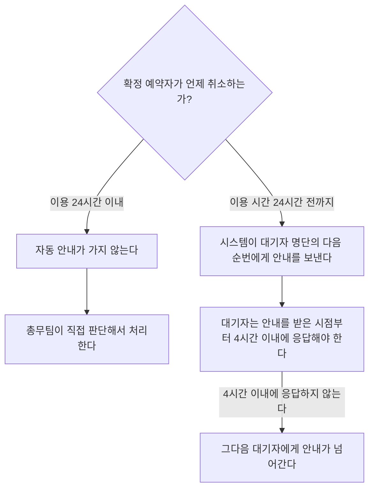

# 회의실 예약 취소 처리

## 조건별 처리

| 상황 | 처리 |
|---|---|
| 확정 예약자가 이용 시간 24시간 전까지 취소한다 | 시스템이 대기자 명단의 다음 순번에게 안내를 자동으로 보낸다 |
| 대기자가 안내를 받는다 | 안내를 받은 시점부터 4시간 이내에 응답해야 한다 |
| 대기자가 4시간 이내에 응답하지 않는다 | 그다음 대기자에게 안내가 넘어간다 |
| 확정 예약자가 이용 24시간 이내에 취소한다 | 자동 안내가 가지 않는다. 총무팀이 직접 판단해서 처리한다 |
| 남은 대기자가 없다 | 해당 시간대가 일반 예약으로 다시 열린다 |

## 취소 시점별 안내

- **남은 대기자가 없으면** 해당 시간대가 일반 예약으로 다시 열린다.