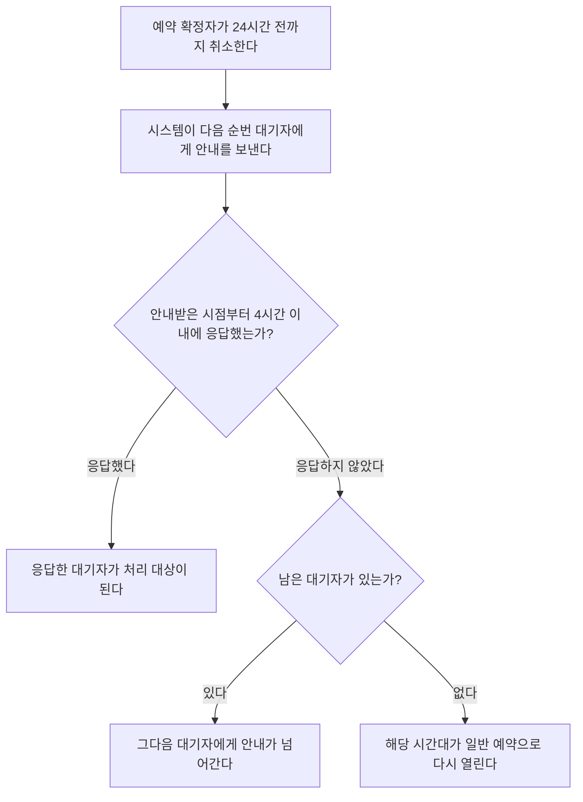

# 회의실 예약 취소 처리

예약 확정자가 이용 시간 24시간 전까지 취소하면 시스템이 대기자 명단의 다음 순번에게 자동으로 안내를 보낸다. 이용 24시간 이내에 취소하면 자동 안내가 가지 않는다. 이 경우 총무팀이 직접 판단해서 처리한다.

## 취소 시점별 처리

| 취소 시점 | 자동 안내 | 처리 주체 |
|---|---|---|
| 이용 시간 24시간 전까지 | 대기자 명단의 다음 순번에게 보낸다. | 시스템 |
| 이용 24시간 이내 | 가지 않는다. | 총무팀이 직접 판단한다. |

## 24시간 전까지 취소한 경우의 흐름

- **응답 기한:** 안내를 받은 대기자는 안내를 받은 시점으로부터 4시간 이내에 응답해야 한다.
- **미응답:** 그 시간 안에 응답하지 않으면 안내가 그다음 대기자에게 넘어간다.
- **대기자 소진:** 남은 대기자가 없으면 해당 시간대가 일반 예약으로 다시 열린다.