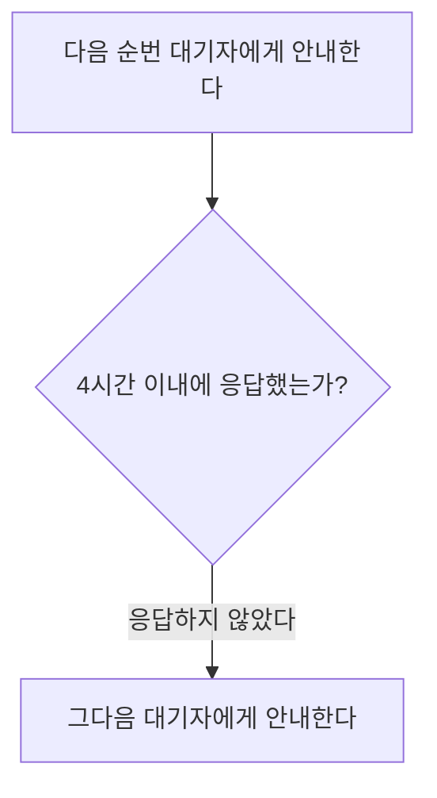

# 회의실 예약 취소 안내

확정된 예약의 취소 시점에 따라 처리 방식이 달라진다.

- **이용 시간 24시간 전까지 취소:** 시스템이 대기자 명단의 다음 순번에게 자동으로 안내한다.
- **이용 24시간 이내에 취소:** 자동 안내가 가지 않는다. 총무팀이 직접 판단해 처리한다.
- **남은 대기자가 없을 때:** 해당 시간대가 일반 예약으로 다시 열린다.

## 대기자 안내와 응답

안내를 받은 대기자는 안내받은 시점부터 **4시간 이내에 응답해야 한다.**

