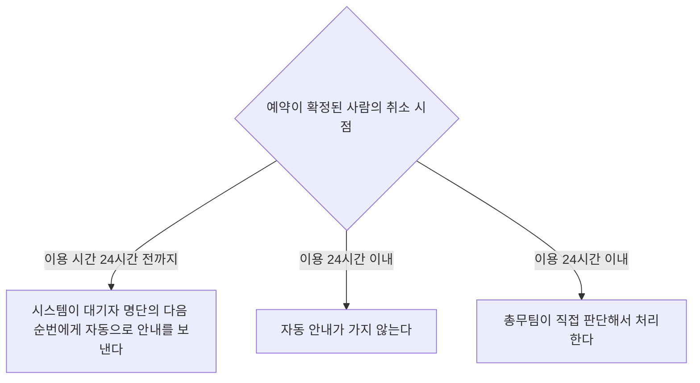
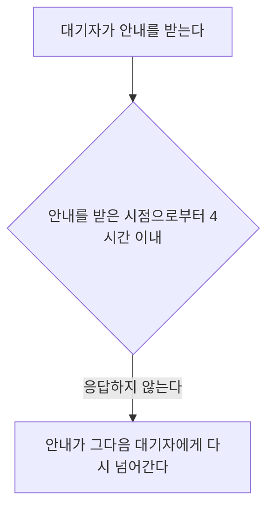
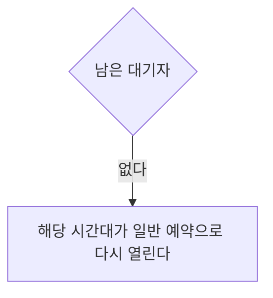

# 회의실 예약 취소 처리

## 처리 기준

| 조건 | 결과 |
|---|---|
| 예약이 확정된 사람이 이용 시간 24시간 전까지 취소한다 | 시스템이 대기자 명단의 다음 순번에게 자동으로 안내를 보낸다 |
| 안내를 받은 대기자가 안내를 받은 시점으로부터 4시간 이내에 응답하지 않는다 | 안내가 그다음 대기자에게 다시 넘어간다 |
| 예약이 확정된 사람이 이용 24시간 이내에 취소한다 | 자동 안내가 가지 않는다 |
| 예약이 확정된 사람이 이용 24시간 이내에 취소한다 | 총무팀이 직접 판단해서 처리한다 |
| 남은 대기자가 없다 | 해당 시간대가 일반 예약으로 다시 열린다 |

## 취소 시점

## 대기자 응답

안내를 받은 대기자는 안내를 받은 시점으로부터 4시간 이내에 응답해야 한다.

## 남은 대기자

