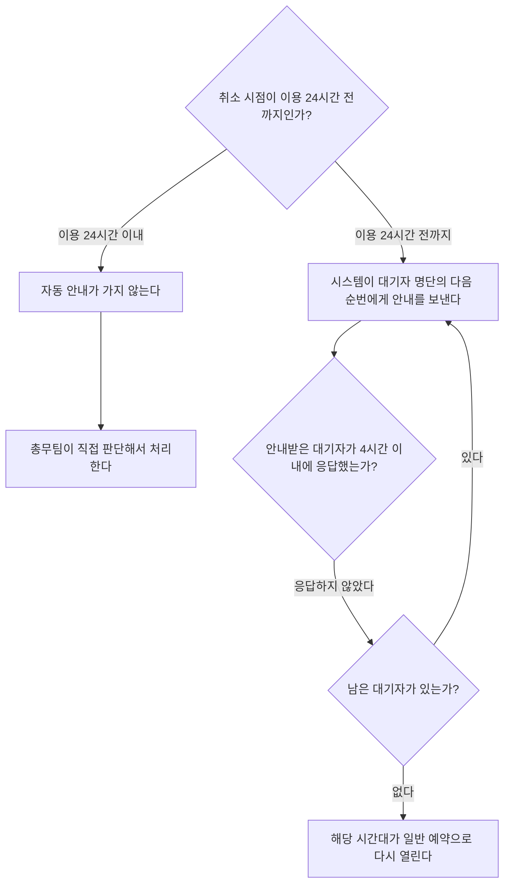

# 회의실 예약 취소 처리

## 처리 흐름

## 단계별 기준

| 취소 시점 | 처리 주체 | 처리 내용 |
|---|---|---|
| 이용 24시간 전까지 | 시스템 | 대기자 명단의 다음 순번에게 자동으로 안내를 보낸다. |
| 이용 24시간 이내 | 총무팀 | 자동 안내 없이 직접 판단해서 처리한다. |

## 대기자 응답

- **응답 기한:** 안내를 받은 시점으로부터 4시간 이내
- **기한 안에 응답하지 않으면:** 그다음 대기자에게 안내가 넘어간다.
- **남은 대기자가 없으면:** 해당 시간대가 일반 예약으로 다시 열린다.

## 참고

- 위 도식은 원문이 정한 분기만 나타낸다. 4시간 이내에 응답한 경우의 후속 처리는 제공된 자료에 기재되어 있지 않다.
- 이용 24시간 이내 취소에서 남은 대기자가 없는 경우의 처리는 제공된 자료에 기재되어 있지 않다.