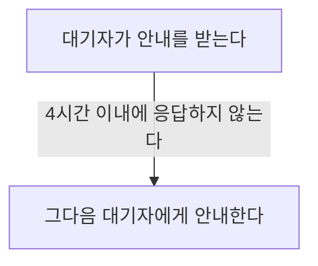

# 회의실 예약 취소 안내

## 이용 시간 24시간 전까지 취소할 때

확정된 예약을 취소하면 시스템이 대기자 명단의 다음 순번에게 자동 안내를 보낸다. 안내를 받은 대기자는 안내를 받은 시점부터 4시간 이내에 응답해야 한다.

## 이용 시간 24시간 이내에 취소할 때

자동 안내가 가지 않는다. 총무팀이 직접 판단해 처리한다.

## 남은 대기자가 없을 때

해당 시간대가 일반 예약으로 다시 열린다.