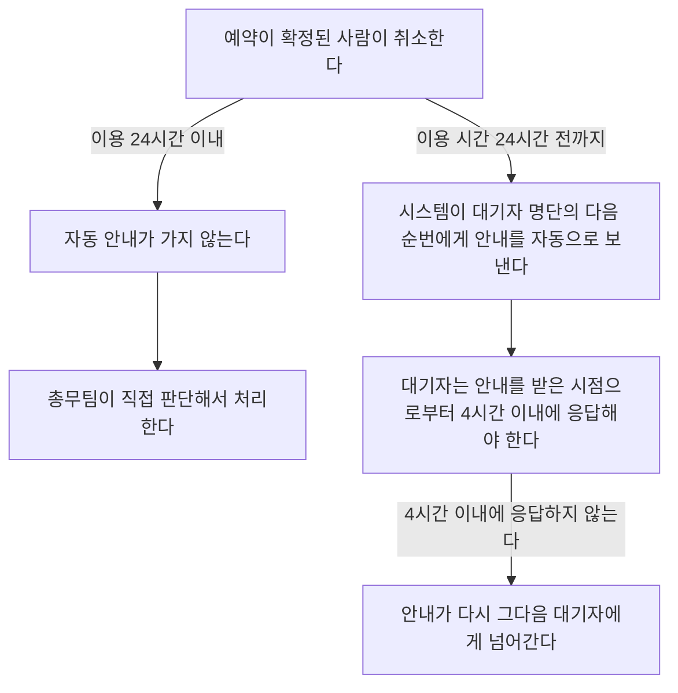

# 회의실 예약 취소 안내

## 조건별 내용

| 조건 | 적용 내용 |
|---|---|
| 이용 시간 24시간 전까지 취소 | 시스템이 대기자 명단의 다음 순번에게 안내를 자동으로 보낸다 |
| 이용 24시간 이내 취소 | 자동 안내가 가지 않는다 총무팀이 직접 판단해서 처리한다 |
| 대기자가 안내를 받음 | 안내를 받은 시점으로부터 4시간 이내에 응답해야 한다 |
| 4시간 이내에 응답하지 않음 | 안내가 다시 그다음 대기자에게 넘어간다 |
| 남은 대기자가 없음 | 해당 시간대가 일반 예약으로 다시 열린다 |

## 취소 안내 흐름

