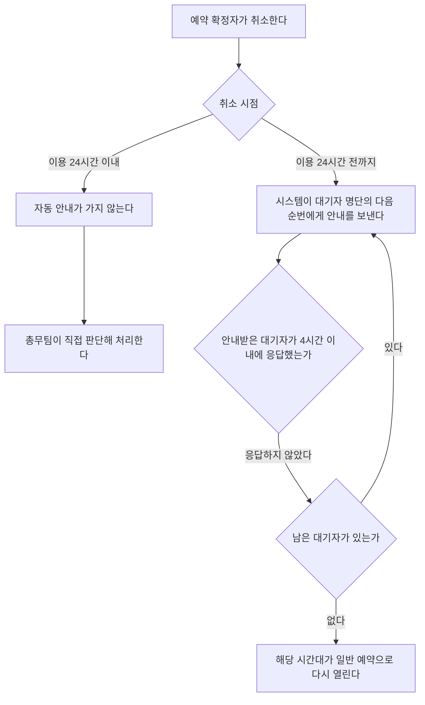

# 회의실 예약 취소 처리 기준

## 처리 흐름

## 취소 시점별 처리

| 취소 시점 | 자동 안내 | 처리 주체 |
|---|---|---|
| 이용 24시간 전까지 | 시스템이 대기자 명단의 다음 순번에게 보낸다 | 시스템 |
| 이용 24시간 이내 | 가지 않는다 | 총무팀이 직접 판단한다 |

## 대기자 응답

- **응답 기한:** 안내를 받은 시점부터 4시간 이내
- **기한 내 응답하지 않으면:** 그다음 대기자에게 안내가 넘어간다.

## 남은 대기자가 없을 때

해당 시간대가 일반 예약으로 다시 열린다.