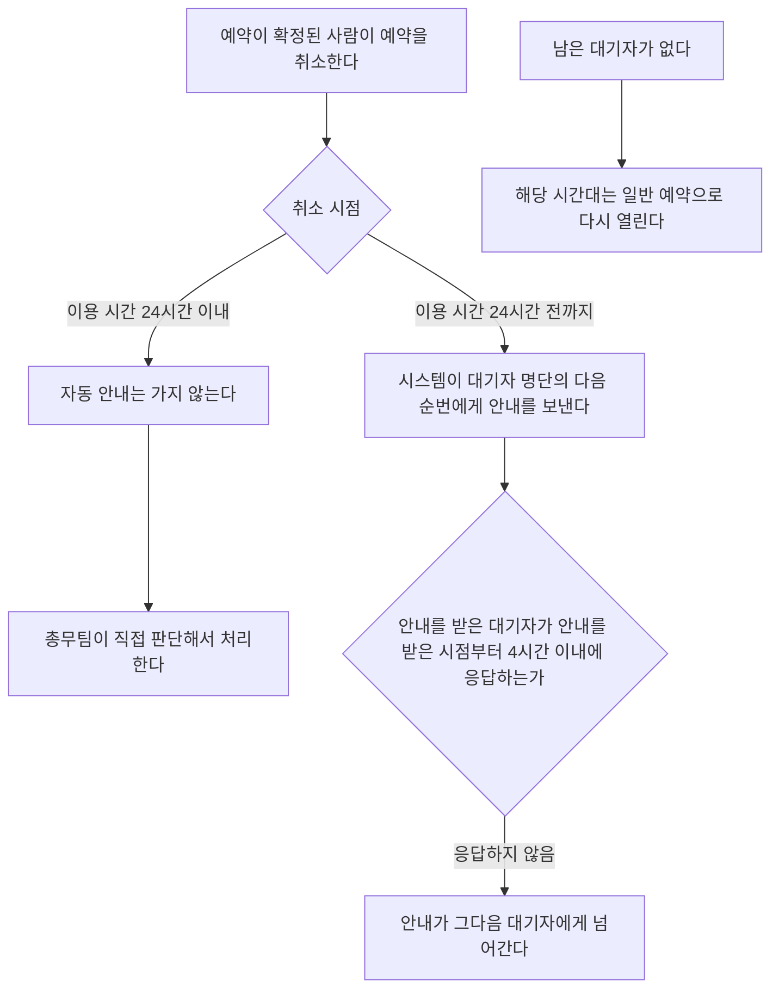

# 회의실 예약 취소

## 취소 시점별 처리

| 조건 | 처리 |
| --- | --- |
| 예약이 확정된 사람이 이용 시간 24시간 전까지 예약을 취소한다. | 시스템이 대기자 명단의 다음 순번에게 안내를 보낸다. |
| 예약이 확정된 사람이 이용 시간 24시간 이내에 예약을 취소한다. | 자동 안내는 가지 않는다. 총무팀이 직접 판단해서 처리한다. |

## 대기자의 응답

안내를 받은 대기자는 안내를 받은 시점부터 4시간 이내에 응답해야 한다.

대기자가 4시간 이내에 응답하지 않으면 안내가 그다음 대기자에게 넘어간다.

## 남은 대기자

남은 대기자가 없으면 해당 시간대는 일반 예약으로 다시 열린다.

