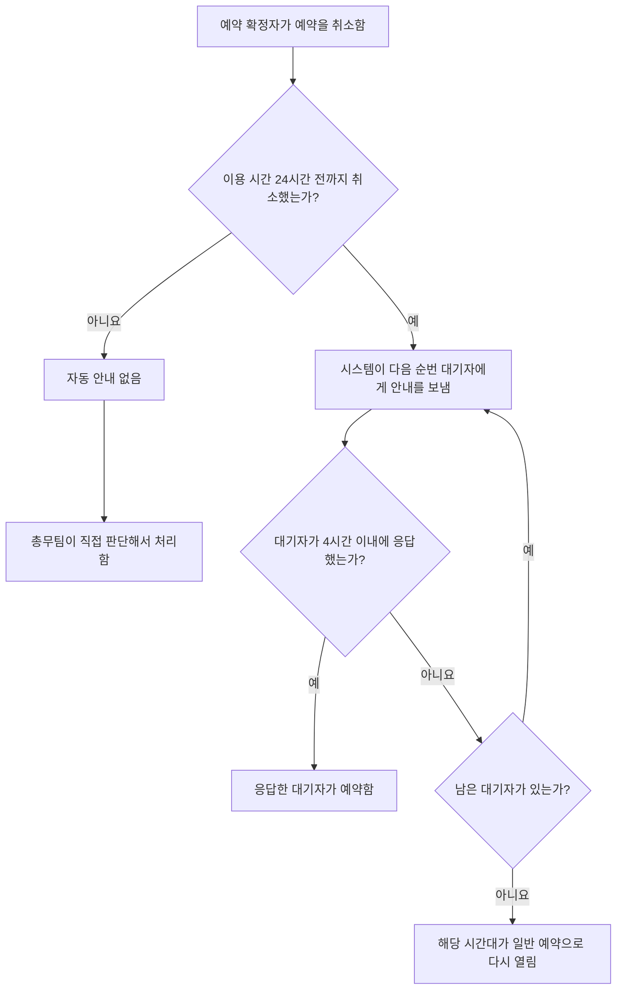

# 회의실 예약 취소 절차

## 취소 시점별 처리

| 취소 시점 | 처리 |
|---|---|
| 이용 시간 24시간 전까지 | 시스템이 자동으로 대기자 명단의 다음 순번에게 안내를 보냅니다. |
| 이용 시간 24시간 이내 | 자동 안내는 가지 않습니다. 총무팀이 직접 판단해서 처리합니다. |

## 이용 24시간 전까지 취소한 경우

1. 예약이 확정된 사람이 이용 시간 24시간 전까지 예약을 취소합니다.
2. 시스템이 대기자 명단의 다음 순번에게 안내를 보냅니다.
3. 안내를 받은 대기자는 안내를 받은 시점부터 4시간 이내에 응답합니다.
4. 대기자가 4시간 이내에 응답하지 않으면, 안내는 그다음 대기자에게 넘어갑니다.
5. 남은 대기자가 없으면, 해당 시간대는 일반 예약으로 다시 열립니다.

## 참고

- 이용 24시간 이내에 취소한 경우, 남은 대기자가 없으면 해당 시간대가 일반 예약으로 다시 열립니다.