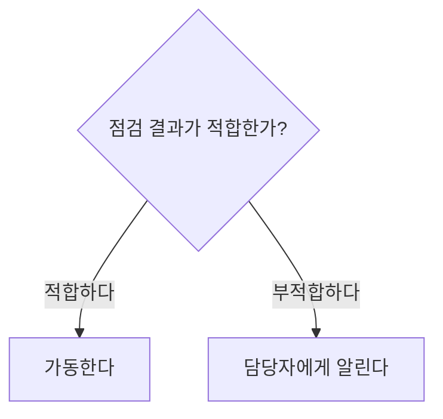

# 독자가 필요한 정보를 찾는 기본형을 선택한다

이 문서의 예시는 가상 자료다. 실제 작업의 인물·수치·결론으로 옮기지 않는다. 기본형은 시작점이며, 사용자 형식과 자료의 관계를 우선한다. 모든 형식을 한 응답에 넣거나 빈 구획을 채우지 않는다.

## L1에서 답과 조건을 먼저 제시한다

일반 설명은 핵심 답·상태와 그 판단을 바꾸는 조건으로 시작한다. 필요한 근거와 행동을 뒤에 연결한다. 첫 문장의 답을 제목·요약·마지막 문장에 반복하지 않는다. 짧은 답에 제목이나 목록을 강제하지 않는다.

원문은 ‘지점이 신청서를 받은 뒤 3영업일 이내에 결과를 알린다. 보완 요청을 받은 신청은 제외한다’다.

- 잘못된 출력은 ‘신청하면 3일 안에 결과가 나온다’다. 수신 주체·기산점·영업일·예외가 바뀌거나 빠졌다.
- 적절한 출력은 ‘지점은 신청서를 받은 뒤 3영업일 이내에 결과를 알린다. 보완 요청을 받은 신청은 제외한다’다. 두 문장만으로 답과 예외를 찾을 수 있으므로 도식을 추가하지 않는다.

자료가 ‘안전 확인 전에는 장치를 켜지 않는다’면 금지를 행동 앞에 둔다. 확인 절차나 확인 주체가 없으면 임의로 만들지 않는다. 요약 요청이 없는 재작성에서는 배경 사실도 임의로 덜어내지 않는다.

## L2에서 같은 기준의 값과 관계를 나란히 둔다

비교·판단에는 대상·비교 속성·값·값의 조건을 연결한다. 동일하지 않은 세금·범위·확인 상태를 머리글 하나로 묶지 않는다. 미기재를 부재·미포함으로 바꾸지 않는다. 숫자 열은 단위와 자릿수를 맞추고, 단위가 다른 값은 구별한다.

전언을 내용·주체·출처 열로 나누기 전에 조사구와 수식어가 어느 서술에 붙는지 대조한다. 문맥으로 귀속이 하나로 정해지지 않으면 원문과 필요한 문맥을 한 주장 단위로 유지한다. 표를 채우려고 조사구를 특정 주체·출처·전달 역할의 칸에 배정하지 않는다. 이때는 중립적인 내용 칸 하나에 문장 전체를 두거나 원래 문단 구조를 유지한다. [귀속 범위를 유지하는 사례](meaning-boundaries.md#전언의-조사구를-역할-칸으로-확정하지-않는다)를 확인한다.

원문은 ‘A 견적서는 120만 원이며 부가세가 별도다. B 견적서는 132만 원이며 세금 조건을 적지 않았다. 설치비 항목은 두 견적서 모두 기재하지 않았다’다.

| 대상 | 기재 금액 | 기재된 세금 조건 | 설치비 항목의 상태 |
|---|---:|---|---|
| A 견적서 | 120만 원 | 부가세가 별도다. | 견적서에 기재되지 않았다. |
| B 견적서 | 132만 원 | 견적서에 기재되지 않았다. | 견적서에 기재되지 않았다. |

‘총액’ 열에 두 값을 넣거나 ‘설치비 미포함’으로 표시하면 근거 없는 범위·상태가 추가된다. 같은 표에 출처와 확인 상태가 필요하면 해당 값 곁의 셀에 둔다. 표가 긴 문장들을 좁은 칸에 가두면 대상별 문단·목록으로 바꾼다.

절차·분기는 원문이 정한 선후와 조건을 보존한다. 화살표의 뜻을 분명히 하고 독립된 사실을 순서나 인과로 연결하지 않는다. 명사형 노드는 대상·상태의 짧은 표지로만 쓴다. 행동·조건·경고는 관계를 알 수 있는 구절이나 문장으로 쓴다.

원문이 ‘점검 결과가 적합하면 가동한다. 부적합하면 담당자에게 알린다’라면 다음 도식은 해당 분기를 보존한다.

원문이 ‘점검했다. 가동했다’라면 점검에서 가동으로 화살표를 추가하지 않는다. 필수 순서·인과가 제시되지 않았기 때문이다. Mermaid를 표시할 수 없는 환경에서는 같은 관계를 번호 없는 조건 목록이나 ASCII 도식으로 전달한다.

## L3에서 변수와 결과의 관계를 탐색하게 한다

수량·단가·할인율을 바꾸며 계산 결과를 비교하거나 상태 전환을 확인해야 하면 [HTML 지침](interactive-html.md)을 따른다. 정적인 값 세 개의 비교만으로 충분하면 L2에 둔다. 사용자가 텍스트만 요청하면 변수 관계도 텍스트와 산출식으로 설명한다.

## L4에서 명시 요청한 영상 제작 자료를 제공한다

사용자가 애니메이션 코드를 요청하면 [영상 지침](video-script.md)을 따른다. ‘과정을 이해하기 쉽게 설명해 달라’는 요청만으로 영상 코드나 TTS 대본을 만들지 않는다. 영상에서도 판단을 바꾸는 조건을 마지막 장면까지 미루지 않는다.

## 기본형 밖의 배치도 목적에 맞으면 사용한다

- 문구 한 줄을 교정하는 요청에는 수정한 한 줄을 제출한다. L1·L2 구획과 설명을 덧붙이지 않는다.
- 사용자가 JSON 키와 형식을 고정하면 그 형식 안의 한국어 값에 KP를 적용한다. 표나 HTML로 변환하지 않는다.
- 두 업체의 긴 조건을 읽어야 하면 대상별 짧은 문단을 쓴다. 비교 대상이 둘이라는 이유로 표를 강제하지 않는다.
- 여러 독립 사건을 한 타임라인에 놓으면 실제 선후로 오해할 때는 사건별 목록을 쓴다.

## 시각 기본값을 자료의 목적에 맞게 조정한다

채팅은 Markdown의 제목·목록·표 범위를 따른다. 별도 색상·정렬·접기 기능이 표시된다고 가정하지 않는다. 출력 첫 화면에서 답·조건·필요한 행동을 찾게 하고, 빈 카드나 반복 요약으로 본문을 나누지 않는다.

HTML 예제는 본문 최대 폭 72rem, 설명 폭 64ch, 1rem 기본 글자와 1.7 줄 높이를 시작값으로 둔다. 이 수치는 KP 패키지의 제품 선택이며 한국어의 보편 기준이 아니다. 큰 제목·본문·보조 설명은 역할로 구분한다. 상태와 경고를 색상만으로 전달하지 않는다. 좁은 화면에서는 한 열로 재배치하고 표의 내용을 잃지 않는다.

## 다음 연구 근거를 기본형에 적용했다

2026-10-20에 확인한 StyleGallery와 Mobbin 근거를 아래와 같이 사용했다. 아래 출처는 설계 기록이다. 스킬 실행 시 해당 서비스나 연결을 요구하지 않는다. 외부 문서를 다시 읽지 않아도 이 문서와 포함 예제로 작업한다.

| 확인한 근거를 식별한다. | 관측·지침을 구별해 적용한다. |
|---|---|
| StyleGallery의 `layout/patterns/containment/content-limiter.md`를 확인했다. 문서 버전은 `sha256:505df6aac4ab3b5a9041cedaa04e74c2253ce2f8b9a12abf3d8835d2a9ce169c`다. 안정 식별자는 `sg:material/path-sha256-e1c9957e26f0e3ee1235a070fbe69d31ed5974bce8c4fe14c63537909991a750`다. | 최대 읽기 폭과 상위 레이아웃의 스크롤 소유를 적용했다. 예제 안에 본문 스크롤 상자를 만들지 않는다. 문서의 영어 폭 예시를 한국어 고정 규칙으로 사용하지 않았다. |
| StyleGallery의 `Typography Roles, Styles, And Representations`를 확인했다. 문서 버전은 `sha256:447b1a05e9c0be605785c6d885c5fc68bbbd47d96780afa1e3780abffabbbdab`다. 안정 식별자는 `sg:material/path-sha256-76663508bb4bf3e2ffc62ff5d0622bf17ee6c0420f11338f1837e981e6379134`다. | 제목·본문·보조 설명을 역할에 따라 나눴다. 보편적인 한 가지 글자 비율을 강제하지 않는다. 이 타이포그래피 문서에 표시된 검토일은 2026-09-21이다. |
| [Mobbin의 Loop 화면](https://mobbin.com/screens/6e184307-9a74-420a-ac1f-e6aad0122485)에서 제목·본문·표의 계층을 확인했다. | 답·설명·수치의 계층을 KP 읽기 순서에 맞췄다. 브랜드와 앱 외곽 UI는 가져오지 않았다. |
| [Mobbin의 Skiff 화면](https://mobbin.com/screens/79083608-a069-488e-9e53-f73770adc8c9)에서 제목·텍스트·표의 구분을 확인했다. | 표와 설명을 별도 역할로 배치했다. 화면 관측을 한국어 이해도 향상의 입증으로 사용하지 않는다. |

기본형의 수락 검사는 조건·경고가 본문과 함께 보이는지, 320px 폭과 확대 상태에서도 대상·값·조건이 연결되는지, 키보드로 입력과 초기화를 할 수 있는지를 확인한다. 스타일 참고 자료만으로 실제 독자의 이해도를 통과 처리하지 않는다.
